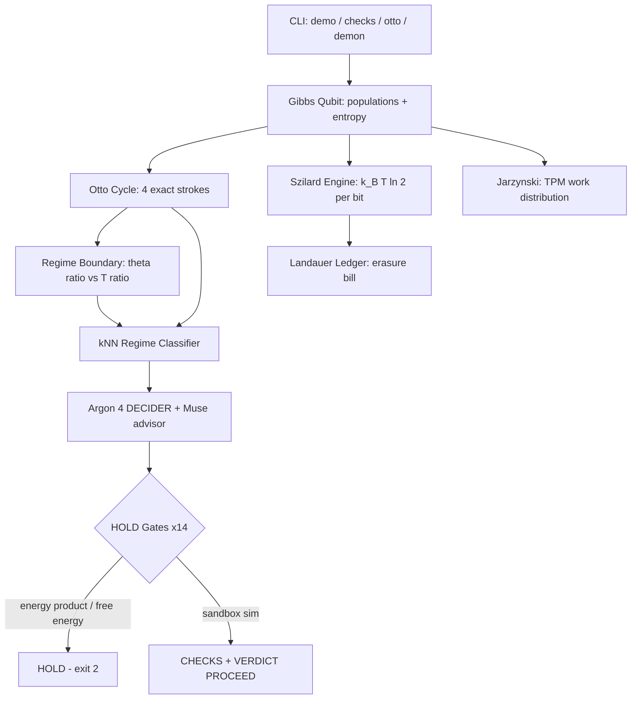
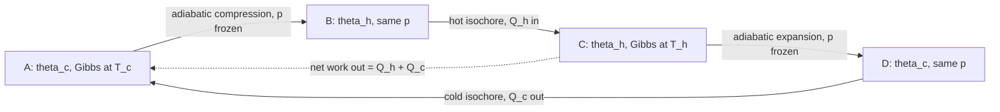
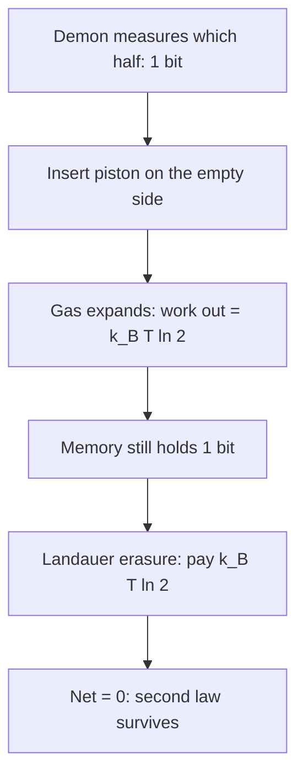
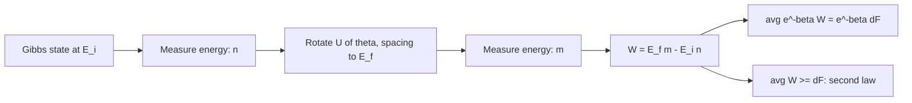
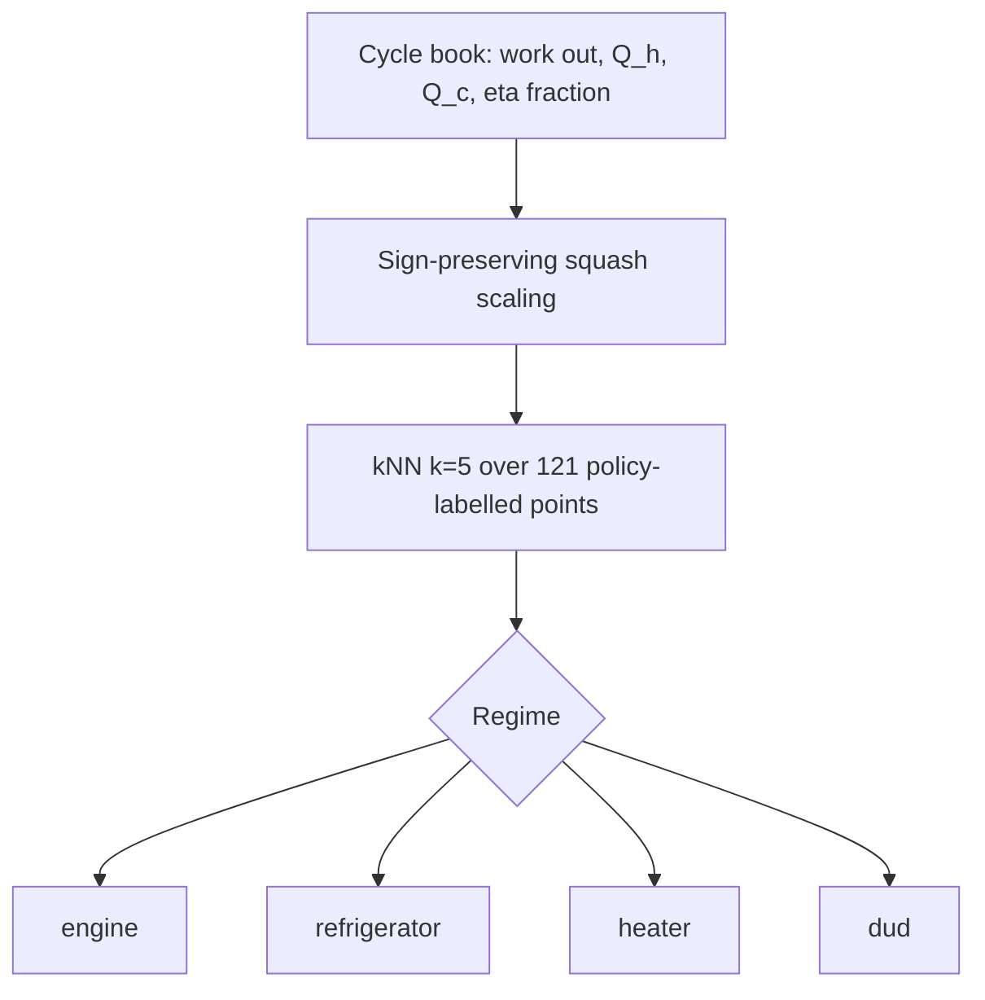
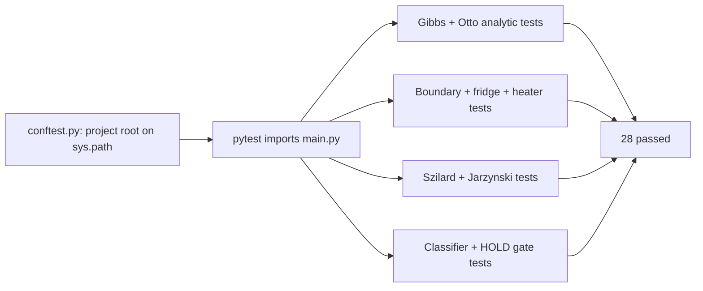
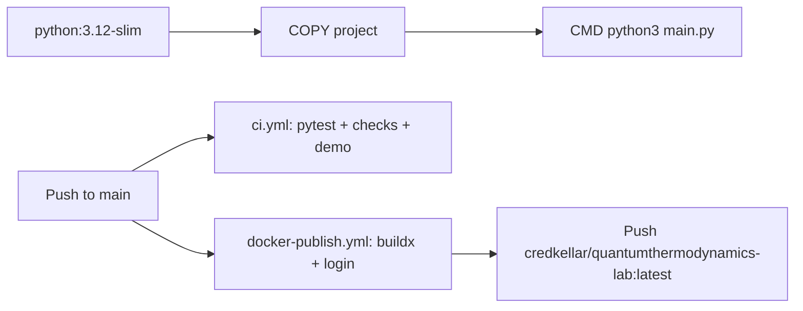

# QuantumThermodynamics-Lab 🌡️⚛️

**Qubit Heat Engine + Information Thermodynamics Lab** — by Darion Kellar

QuantumThermodynamics-Lab is an **educational quantum thermodynamics lab** in ONE pure-Python file. It does **exact Gibbs arithmetic on one toy qubit** — no sampling, no noise, every number a closed-form consequence of the Boltzmann weights:

- A **four-stroke qubit Otto cycle** whose efficiency falls out at exactly **η = 1 − θ_c/θ_h**, always below Carnot, with the engine → refrigerator flip at one **derived** boundary (θ_h/θ_c = T_h/T_c) 🔁
- A **Szilard engine + Maxwell demon** whose one bit of information is worth exactly **k_B T ln 2** of work — and whose **Landauer erasure bill** is kept in the same ledger, so the net is exactly zero and the second law survives 📒
- A **two-point-measurement work distribution** for a driven qubit whose Jarzynski average ⟨e^(−βW)⟩ matches e^(−βΔF) to float precision — **abs err 0.0** at the demo protocol 📐
- **Entropy bookkeeping at every stroke corner**, a labelled friction model that turns the fridge into a heater, and a from-scratch kNN regime classifier (engine / refrigerator / heater / dud) 🏷️

Honest scope, stated up front: every temperature and level spacing is a **labelled teaching value**. This lab operates **nothing real**: no heat engine, no refrigerator, no cryogenics. Nothing here is measured device data, and no output is an efficiency specification. Every energy-product / free-energy / product claim sits behind a permanent HOLD gate (14 total). 🔒

[](https://github.com/kimanicollier44-cmyk/QuantumThermodynamics-Lab/actions/workflows/ci.yml)
[](https://github.com/kimanicollier44-cmyk/QuantumThermodynamics-Lab/actions/workflows/docker-publish.yml)

> ℹ️ These are the **live** workflow badges for this repo. They activate as soon as the `ci.yml` and `docker-publish.yml` files from the paste pack are pasted into `.github/workflows/` — until then they have nothing to report yet.

## 🧰 Tech Stack Badges & Full Architecture Tech Stack

### 💻 Core Programming Languages & Core Systems


- 🐍 Python 3.12, pure standard library (`math`, `hashlib`, `json`, `sys`) — zero dependencies, zero network, deterministic (double-run byte-identical)
- 🌡️ Thermodynamics core: Gibbs populations `1/(e^(βE)+1)`, von Neumann entropy as binary entropy, exact stroke-by-stroke work/heat bookkeeping, Jarzynski averages over the enumerated TPM distribution — every formula asserted against its analytic value in CHECKS
- 🔢 Exact SI constants (2019 definitions): k_B = 1.380649e-23 J/K, h = 6.62607015e-34 J·s, 1 eV = 1.602176634e-19 J
- 🧠 TinyML kNN regime classifier (from scratch, stdlib): engine / refrigerator / heater / dud from work sign + heat signs + η/Carnot fraction
- 🪑 Council seats: Gemini Argon 4 DECIDER (names-only, tighten-only) + Muse advisor (never overrides HOLD) + Google Flow plan-only (rendered = False, live = 0)

### ⛓️ Web3 & Infrastructure

- 🚫 **Not applicable — honestly.** No blockchain, no Web3, no tokens: the "infrastructure" in this lab is one labelled toy qubit, two labelled heat baths, and a paper ledger inside one offline file. No fake badges here.

### ⚙️ Platform Support & Hardware Architecture


- 🖥️ Pure Python — runs anywhere Python 3.12+ runs (Linux, macOS, Windows), plus the `python:3.12-slim` Docker image
- 🔒 No hardware is controlled, ever: real engines, refrigerators, and cryogenic plant are permanent HOLD gates (see the gate table below)

### ⚡ Low-Level Infrastructure & Performance

- 🚫 **No low-level code — honestly.** No C, no C++, no GPU, no compiled extensions: this is one interpreted Python file on purpose, so every number can be read, checked, and diffed. Performance here means exact arithmetic — closed-form Gibbs weights and a fully enumerated 4-outcome work distribution, no Monte Carlo anywhere.

### 🛠️ DevOps & Build Tools


- 🐳 Docker (`python:3.12-slim`), GitHub Actions CI + Docker Publish (delivered in the paste pack)
- 🎯 Target image: `credkellar/quantumthermodynamics-lab:latest`
- 🧪 Tests: `pytest` (28 tests) + the built-in CHECKS suite (54 checks) in `main.py`

### ☁️ Cloud Providers

- 🚫 **None — honestly.** No cloud provider is used or needed: the lab runs fully offline on your own machine or in a local Docker container. Docker Hub appears only as the registry the publish workflow pushes the image to.

## What this does?

1. ⚖️ **Gibbs qubit basics** — the excited-state population `p = 1/(e^(βE)+1)`, internal energy `U = p·E`, free energy `F = −k_B T ln Z`, and the von Neumann entropy as the binary entropy of p: exactly 0 for a pure state, exactly **ln 2** at p = ½. Every later number is built from these four lines.
2. 🔁 **Otto cycle, stroke by stroke** — adiabatic compression (populations frozen, spacing θ_c → θ_h), hot isochore (population relaxes to Gibbs at T_h), adiabatic expansion, cold isochore. At the labelled demo point (θ 0.5 → 1.0, baths 0.4 K / 2.0 K) the corners are p = 0.222700 → 0.377541 and the cycle delivers **0.077420 k_B·K = 1.0689e-24 J** of work per cycle.
3. 🎯 **The efficiency is a theorem here** — η comes out at exactly **1 − θ_c/θ_h = 0.500000**, because the same population difference (p_C − p_A) drives both the net work and the absorbed heat. Carnot allows 0.800000 at these baths; the checks assert η < η_Carnot at the demo point and across a parameter scan.
4. 🧭 **The flip boundary is derived, not quoted** — net work is (θ_h − θ_c)(p_C − p_A), so the engine runs iff θ_h/T_h < θ_c/T_c. Set θ_h/θ_c = T_h/T_c exactly and both Gibbs populations coincide: work, heats, everything = **0** — the dud boundary, computed in the lab.
5. 🧊 **Refrigerator point** — swap the bath ratio past the boundary (T_c = 0.6 K, T_h = 1.0 K) and the same cycle runs backwards: 0.017000 k_B·K of work in extracts 0.017000 k_B·K from the cold bath, COP = **1.000000** against a Carnot COP of 1.500000 — below the limit, as it must be.
6. 🔥 **Friction heater** — a labelled loss model pays friction work in and dumps it as heat into the cold bath. Add 0.05 k_B·K of friction to the fridge point and Q_c flips from +0.017000 to **−0.033000**: work in, heat dumped to *both* baths — a heater, and the first law still closes to 1e-15.
7. 👿 **Szilard engine + the demon's bill** — one bit of which-half information is worth **k_B T ln 2 = 2.871e-21 J = 0.017919 eV** at 300 K (exact SI k_B). The table runs 1 → 1024 bits (18.349303 eV), and the demon ledger subtracts the Landauer erasure cost — the same k_B T ln 2 per bit — leaving **net exactly 0**. The second law survives in the same ledger that pays the demon.
8. 📐 **Jarzynski equality, enumerated exactly** — a driven qubit (βE 1.0 → 1.6, rotation 0.7 rad) has exactly four TPM work outcomes. Their probabilities sum to 1, and ⟨e^(−βW)⟩ = **0.878657** lands on e^(−βΔF) = **0.878657** with **abs err 0.0** — while ⟨βW⟩ = 0.248301 ≥ βΔF = 0.129361, the second law in the same bookkeeping (dissipated work 0.118940).
9. 🌋 **Entropy bookkeeping** — von Neumann entropy at all four corners (0.530304 k_B at A/B, 0.662847 k_B at C/D): frozen across the adiabats, traded across the isochores, and the universe's entropy production over the cycle is **+0.116130 k_B ≥ 0**, asserted for engine and fridge alike.
10. 🏷️ **Regime classifier + seats + checks** — a from-scratch kNN over a 121-point grid labelled by the lab's own regime policy sorts the four demo cycles into engine / refrigerator / dud / heater, with Argon 4 DECIDER (sha256 trace), Muse advisor, Google Flow plan-only, and a built-in CHECKS suite (54 checks).

## 🗺️ How it works — diagram per script

### `main.py` — the whole lab



### Otto cycle — the four strokes



### Szilard engine + demon ledger



### Jarzynski — two-point measurement protocol



### kNN regime classifier



### `tests/test_main.py` + `conftest.py` — verification



### `Dockerfile` + CI flow — container & publish



## Why is this cool?

1. 🎯 The Otto efficiency is **proved by the arithmetic**: η = 1 − θ_c/θ_h falls out of the stroke book to 1e-12, because one population difference drives both work and heat — you watch a textbook theorem happen.
2. 🧭 The engine/refrigerator flip is **one derived ratio**: match θ_h/θ_c to T_h/T_c and the cycle's output is exactly zero — the boundary is a computation, not a footnote.
3. 👿 The demon is **audited, not celebrated**: extraction and erasure sit in the same ledger and cancel to exactly 0.0 J — the cleanest possible answer to "does information break the second law?"
4. 📐 Jarzynski lands **exactly**: ⟨e^(−βW)⟩ vs e^(−βΔF) differ by 0.0 at the demo protocol — a fluctuation theorem verified to float precision from a 4-outcome distribution you can print on one screen.
5. 🔥 Friction **creates a fourth regime**: one labelled loss term flips the fridge's cold heat from +0.017 to −0.033 and the classifier watches a refrigerator become a heater.
6. 🧊 The fridge COP (1.000) sits **below** its Carnot COP (1.500) by construction and by check — the lab can no more beat Carnot than a real machine can.
7. 🌋 Entropy is **kept at every corner**, not just asserted at the end: frozen on adiabats, traded on isochores, and the universe's production is a printed, asserted +0.116130 k_B.
8. 🔢 The Szilard bit is priced with **exact SI constants**: 2.871e-21 J at 300 K — small enough to be honest, exact enough to check.
9. 🏷️ The classifier's labels come from the lab's **own regime policy** over first-law-consistent grid points — it interpolates the physics bookkeeping instead of inventing categories.
10. 🎯 Deterministic end to end: run it twice, get byte-identical output — a thermodynamics lab you can diff.

## What problems this solves?

1. ❌ **Problem:** Quantum thermodynamics is usually taught as slogans ("quantum engines beat Carnot!"). ✅ **Solution:** The Otto efficiency and COP are computed exactly and asserted *below* Carnot at every scanned point — the lab structurally cannot overclaim.
2. ❌ **Problem:** Maxwell's demon gets presented as a second-law loophole. ✅ **Solution:** The demon ledger carries the Landauer erasure bill in the same table as the earnings; net = 0, asserted.
3. ❌ **Problem:** The engine/refrigerator boundary is quoted as a fact to memorise. ✅ **Solution:** It is derived from the population condition p_C > p_A and demonstrated at the exact matched-ratio point, where every flow vanishes.
4. ❌ **Problem:** Fluctuation theorems sound like magic ("sometimes the second law fails"). ✅ **Solution:** The full 4-outcome work distribution is enumerated; Jarzynski holds exactly and ⟨W⟩ ≥ ΔF holds in the same book — fluctuations average out, they don't repeal anything.
5. ❌ **Problem:** Friction and loss are hand-waved out of textbook cycles. ✅ **Solution:** A labelled friction term with a visible consequence — it flips a regime — and the first law still closes to 1e-15 with the loss included.
6. ❌ **Problem:** Entropy production is asserted globally, never located. ✅ **Solution:** Corner-by-corner von Neumann entropies show exactly which strokes create entropy (the isochores) and which cannot (the adiabats).
7. ❌ **Problem:** "Information is physical" stays a bumper sticker. ✅ **Solution:** One bit is priced three ways — Szilard work out, Landauer cost in, bath entropy gain ln 2 — all from exact SI k_B.
8. ❌ **Problem:** Simulation outputs get dressed up as device data. ✅ **Solution:** Every parameter is labelled a teaching value and `measured_data_claim` is a permanent HOLD gate.
9. ❌ **Problem:** Regime words (engine/fridge/heater) get used loosely. ✅ **Solution:** A written regime policy over (work sign, heat signs, η fraction) labels both the training grid and the demo cycles — the classifier must agree with the policy, and CHECKS enforce it.
10. ❌ **Problem:** Toy models quietly imply a product is next. ✅ **Solution:** 14 named HOLD gates return exit code 2 for every energy-device, refrigeration-product, free-energy, or efficiency-spec claim, forever.

## How to install this?

1. 📋 Clone or download this project folder.
2. 🐍 Make sure Python 3.12+ is installed: `python3 --version`
3. ▶️ Run the full demo + checks (no arguments needed):

```bash
python3 main.py
```

4. 🧪 Run the test suite:

```bash
pip install pytest
python3 -m pytest -q
```

5. 🎛️ Try the other commands:

```bash
python3 main.py checks     # 54 built-in checks
python3 main.py otto       # engine / fridge / boundary / heater books (JSON)
python3 main.py demon      # Szilard table + demon ledger (JSON)
python3 main.py jarzynski  # TPM work distribution + Jarzynski averages (JSON)
python3 main.py classify   # kNN regime classifier report
python3 main.py brains     # Argon 4 + Muse + Flow seats
python3 main.py holds      # list all 14 HOLD gates
python3 main.py hold-demo  # exits 2 - gated actions stay HOLD
```

6. 🐳 Or run it in Docker:

```bash
docker build -t credkellar/quantumthermodynamics-lab:latest .
docker run --rm credkellar/quantumthermodynamics-lab:latest
```

## Requirements

- 🐍 Python 3.12 or newer
- 📦 Dependencies: **none** (standard library only)
- 🌐 Network: **none** — fully offline
- 🧪 For tests only: `pytest`
- 🐳 Optional: Docker

## FULL project structure tree

```text
quantumthermodynamics-lab/
├── main.py                  # the whole lab: Gibbs qubit, Otto cycle, regime boundary, Szilard + Landauer, Jarzynski TPM, classifier, seats, HOLD gates
├── conftest.py              # puts the project root on sys.path for tests
├── tests/
│   └── test_main.py         # 28 pytest tests: Gibbs, Otto, boundary, fridge, heater, Szilard, Jarzynski, classifier, gates, determinism
├── assets/
│   └── cover.png            # README cover image (2736 x 912)
├── Dockerfile               # python:3.12-slim, runs the demo
├── .gitignore               # __pycache__/, .pytest_cache/, *.pyc
└── README.md                # this file
```

> 📦 Delivered separately as paste packs (not in this tree): `.github/workflows/ci.yml` + `docker-publish.yml`, and the Docker Hub pack (100-char description, 350-char About, overview, categories).

## 🔒 HOLD gates — all 14, permanent

| # | Gate | What stays held |
|---|------|-----------------|
| 1 | `energy_device_claim` | No real heat engine, generator, or power device; this is one toy qubit on paper |
| 2 | `free_energy_claim` | No free-energy or over-unity claim; every joule in this lab is accounted for |
| 3 | `perpetual_motion_claim` | No perpetual-motion claim of either kind, ever |
| 4 | `efficiency_product_claim` | The toy Otto efficiency is not a product efficiency specification |
| 5 | `refrigeration_product_claim` | No refrigerator, freezer, or air-conditioning product claim |
| 6 | `cryogenic_operation_claim` | No directing real cryogenic plant or dilution refrigerators from a sim |
| 7 | `quantum_hardware_cooling_claim` | No claim about cooling real quantum computers or their operating budgets |
| 8 | `medical_cooling_claim` | No medical cold-chain, cryotherapy, or organ-preservation claim |
| 9 | `data_center_cooling_claim` | No data-center cooling design or savings claim |
| 10 | `battery_thermal_claim` | No battery thermal-management or EV range claim from toy arithmetic |
| 11 | `measured_data_claim` | Simulation output must never be presented as measured device data |
| 12 | `second_law_violation_claim` | The demon and the fluctuation theorems confirm the second law; they never violate it |
| 13 | `investment_claim` | No investment claim; a labelled toy cycle is not a prospectus |
| 14 | `safety_certification_claim` | No certifying that a real thermal system is safe or efficient |

🧑‍⚖️ **Council seats:** Gemini Argon 4 Extended Thinking — DECIDER (names-only, tighten-only, MAP → MODEL → STRESS → DECIDE, sha256 trace, `can_override_hold = False`) · Muse — advisor (`can_override_hold = False`) · Google Flow — plan-only (`rendered = False`, `live = 0`).

✅ **Verification:** pytest **28 passed** (project + clean copy) · built-in CHECKS **54/54** · double-run output **byte-identical** · `hold-demo` exits **2** · `main.py` **729 lines**, pure stdlib, zero network.

## 🧒 5th-grade English section

Imagine a tiny, tiny machine with just **one switch** that can be off or on. Heat makes the switch flip on sometimes, and cold makes it stay off. This lab plays with that one switch like a pretend engine. 🌡️

- The switch has a **low step** and a **high step**. Squeeze it up to the high step, warm it up so it flips on more, let it drop back down, then cool it off. Going around that loop can **push a tiny bit of work out** — like a water wheel, but for heat. 🔁
- There is an exact rule for how good the loop can be, and a speed limit set by a scientist named Carnot. This lab's loop always stays **under** the speed limit — and the computer checks that every time. 🎯
- Turn the temperatures around and the same loop runs **backwards**: it takes work in and moves heat from the cold side to the warm side. That is how a fridge works! Add too much rubbing (friction) and it stops fridging and just makes heat — like a motor stuck in a box. 🧊
- A famous pretend creature called **Maxwell's demon** sorts fast and slow air bits and seems to get work for free. But the demon has to **remember** what it saw, and erasing its memory costs exactly as much as it earned. The lab keeps the demon's bills in the same notebook as its earnings — total: **zero**. The universe's rules stay safe. 👿
- Sometimes the tiny switch does surprising jumps, but when you add up **all** the jumps with a special math rule (named after Jarzynski), it lands **exactly** on the fair answer. This lab counts every jump and shows it landing perfectly. 📐
- This project is a **pretend lab on a computer**. It does not build a real engine or a real fridge. It teaches how heat, cold, and information follow rules that nobody — not even a demon — gets to break. 💻

---

MIT © 2026 Darion Kellar · QuantumThermodynamics-Lab — educational simulation only 🌡️
